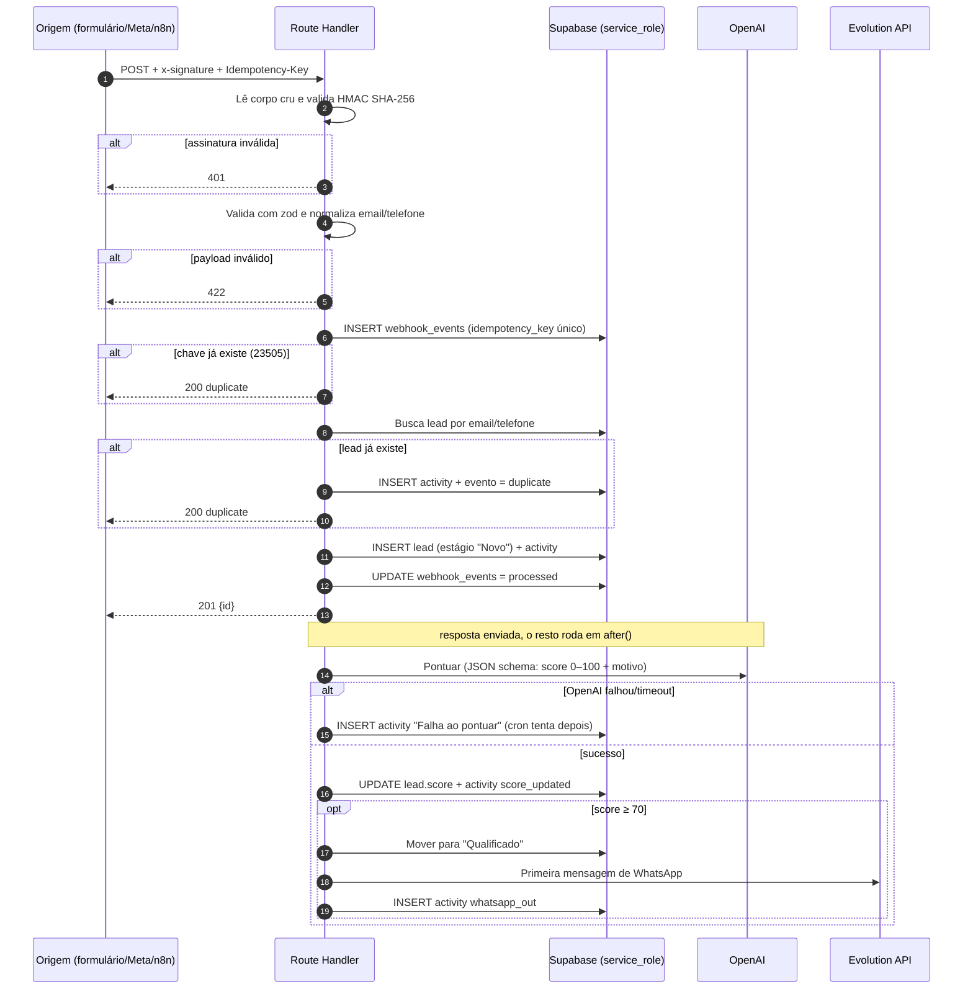

# BlackCore CRM: arquitetura

## 0. Executar o painel

O painel usa Next.js App Router e Supabase Auth/Database. Na raiz do projeto:

```bash
npm install
npm run dev
```

Configure `.env.local` com `NEXT_PUBLIC_SUPABASE_URL` e uma chave pública válida: `NEXT_PUBLIC_SUPABASE_PUBLISHABLE_KEY` ou `NEXT_PUBLIC_SUPABASE_ANON_KEY`. O servidor também aceita `SUPABASE_URL`, `SUPABASE_PUBLISHABLE_KEY` e `SUPABASE_ANON_KEY`. As operações administrativas precisam de `SUPABASE_SECRET_KEY` ou `SUPABASE_SERVICE_ROLE_KEY`; nunca exponha essa chave com o prefixo `NEXT_PUBLIC_`. No `npm run dev`, apenas requisições locais (`localhost`/`127.0.0.1`) ignoram o login e usam a chave secreta exclusivamente no servidor. O script vincula o Next a `127.0.0.1`; em produção a autenticação e a RLS continuam ativas. A página `/setup` explica a configuração quando as variáveis públicas ainda não estão disponíveis.

### Evolution API local

O arquivo `docker-compose.whatsapp.yml` sobe Evolution API 2.3.7, PostgreSQL e Redis. É necessário instalar e iniciar Docker Desktop no Windows. Copie `.env.evolution.example` para `.env.evolution` (arquivo ignorado pelo Git) e substitua os três valores por segredos aleatórios. Depois execute `docker compose --env-file .env.evolution -f docker-compose.whatsapp.yml up -d`. A API fica disponível somente no computador em `http://localhost:8080`.

Configure no `.env.local` `EVOLUTION_API_URL=http://127.0.0.1:8080`, `EVOLUTION_API_KEY` com o mesmo valor de `AUTHENTICATION_API_KEY` e `EVOLUTION_INSTANCE` com o nome da instância criada na Evolution. Gere também `WHATSAPP_WEBHOOK_SECRET` com um segredo independente. Para que o contêiner alcance o servidor CRM local, execute `npm run dev:whatsapp` e configure o webhook da instância para `http://host.docker.internal:3001/api/webhooks/evolution`, com cabeçalho `x-webhook-secret` igual a `WHATSAPP_WEBHOOK_SECRET` e evento `MESSAGES_UPSERT`. Esse modo de desenvolvimento escuta na interface de rede local; mantenha o Firewall do Windows ativo e não exponha a porta 3001 à internet.

A Evolution API conecta um número de WhatsApp que você já controla; ela não fornece números gratuitos. Em produção, avalie a WhatsApp Business Platform oficial da Meta, pois automação por clientes não oficiais pode estar sujeita a restrições da plataforma.

Antes do primeiro acesso, aplique as migrations do projeto Supabase. O primeiro usuário criado no Supabase Auth recebe o papel `admin`; a migration `0002` também vincula usuários Auth preexistentes sem perfil (o mais antigo vira admin se ainda não houver perfis). Depois entre em `/login`. O painel não usa leads de demonstração: sem registros, mostra estados vazios até que leads sejam cadastrados ou recebidos pelo webhook.

O painel oferece visão geral, busca e filtro de leads, cadastro/edição/detalhe com atividades, funil com movimentação entre etapas, relatórios, gestão de equipe, configuração de etapas e status das integrações. `/conversations` reúne mensagens de WhatsApp recebidas e enviadas. Administradores podem enviar PDFs/TXTs à base de conhecimento em `/settings/knowledge`; os textos são divididos em trechos e indexados com `text-embedding-3-small`. O assistente só responde quando encontra contexto relevante e não responde quando não consegue fundamentar a resposta. Configure a Evolution API e `WHATSAPP_WEBHOOK_SECRET` no servidor, envie eventos `messages.upsert` para `/api/webhooks/evolution` usando o cabeçalho `x-webhook-secret` e ative o atendimento em Integrações. `/cadastro` permite criar uma conta Supabase Auth; novos usuários recebem o papel `sales` pela trigger, e o primeiro usuário do workspace recebe `admin`. Configure a URL de callback atual do ambiente (`/auth/callback`) na lista de redirecionamentos permitidos do Supabase Auth. O banco continua sendo a fonte de verdade; RLS aplica as permissões descritas abaixo.

## 1. Banco de dados

Arquivo: `supabase/migrations/0001_init.sql`. Rode com `supabase db push` ou cole no SQL Editor.
Execute também as migrations `0002_backfill_existing_profiles.sql`, `0003_whatsapp_automation.sql` e `0004_whatsapp_knowledge_assistant.sql`, na ordem, para as configurações do WhatsApp e a base vetorial.

| Tabela | Papel |
|---|---|
| `profiles` | Usuários (1:1 com `auth.users`). Cargo: `admin`, `manager`, `sales`. O primeiro usuário cadastrado vira admin. |
| `pipeline_stages` | Estágios do funil, com ordem, cor, probabilidade e flags `is_won`/`is_lost`. 7 estágios de seed. |
| `leads` | Lead com dono, estágio, `position` (ordem no Kanban), score IA, `raw_payload` e chaves únicas (email, telefone, origem + id externo). |
| `activities` | Linha do tempo do lead. Append-only. `actor_id` nulo significa sistema ou IA. |
| `webhook_events` | Caixa de entrada dos webhooks: idempotência, auditoria e reprocessamento. |
| `crm_settings` | Configurações de mensagens e do atendimento automático, editáveis por administradores. |
| `knowledge_documents` / `knowledge_chunks` | Documentos extraídos e trechos com embeddings vetoriais consultados pelo assistente. |
| `whatsapp_inbox_events` | Idempotência e auditoria das mensagens recebidas pela Evolution API. |

Decisões:
- **Single-tenant** com 3 papéis. Para multiempresa, adicione `organization_id` e inclua na RLS.
- **Triggers** cuidam do que não pode depender do front: `status` e `closed_at` ao mover para Ganho/Perdido, log automático de mudança de estágio e de responsável, e trava de escalada de cargo.
- **RLS**: `sales` vê os próprios leads e a fila sem dono; `manager` e `admin` veem tudo. Atividades herdam a visibilidade do lead. `webhook_events` só o admin lê. Webhooks e crons usam `service_role`.
- **Kanban**: `position` é `double precision`. Ao soltar um card entre dois vizinhos, grave a média das posições deles e nenhuma outra linha precisa ser atualizada.
- Rode `supabase gen types typescript` para gerar `types/database.ts`.

## 2. Estrutura de pastas

```
.
├─ middleware.ts                    # renova a sessão e redireciona quem não está logado
├─ supabase/
│  ├─ migrations/0001_init.sql
│  └─ config.toml
├─ app/
│  ├─ layout.tsx                    # <html class="dark">, fontes, Toaster
│  ├─ globals.css
│  ├─ (auth)/
│  │  ├─ layout.tsx                 # layout minimalista, centralizado
│  │  └─ login/page.tsx
│  ├─ auth/
│  │  ├─ callback/route.ts          # troca o code do Supabase por sessão
│  │  └─ signout/route.ts
│  ├─ (app)/                        # ÁREA PROTEGIDA
│  │  ├─ layout.tsx                 # getUser() no servidor; sem sessão → /login; sidebar + topbar
│  │  ├─ loading.tsx
│  │  ├─ dashboard/page.tsx         # KPIs: leads/dia, conversão, receita por estágio
│  │  ├─ pipeline/
│  │  │  ├─ page.tsx                # Server Component: busca estágios + leads
│  │  │  └─ _components/            # board.tsx (DndContext), column.tsx, lead-card.tsx
│  │  ├─ leads/
│  │  │  ├─ page.tsx                # tabela com busca, filtros e paginação
│  │  │  ├─ new/page.tsx
│  │  │  └─ [id]/
│  │  │     ├─ page.tsx             # detalhe + timeline de atividades
│  │  │     └─ _components/
│  │  └─ settings/
│  │     ├─ team/page.tsx           # só admin: convidar, cargo, ativar/desativar
│  │     ├─ pipeline/page.tsx       # editar estágios
│  │     └─ integrations/page.tsx   # chaves do webhook, status da Evolution
│  └─ api/
│     ├─ webhooks/
│     │  ├─ leads/route.ts          # entrada de leads (seção 3)
│     │  └─ evolution/route.ts      # mensagens recebidas no WhatsApp → activities
│     ├─ leads/[id]/score/route.ts  # re-pontuar manualmente
│     └─ cron/
│        ├─ rescore/route.ts        # leads com score nulo
│        └─ follow-ups/route.ts     # lembretes e mensagens agendadas
├─ features/                        # lógica por domínio
│  ├─ leads/    { actions.ts, queries.ts, schemas.ts }   # Server Actions + zod
│  ├─ pipeline/ { actions.ts (moveLead), queries.ts }
│  └─ team/     { actions.ts }
├─ lib/
│  ├─ supabase/ { client.ts, server.ts, admin.ts, middleware.ts }
│  ├─ ai/score-lead.ts
│  ├─ integrations/evolution.ts
│  ├─ webhooks/verify-signature.ts
│  └─ utils.ts                      # cn()
├─ components/
│  ├─ ui/                           # shadcn/ui
│  └─ layout/                       # sidebar.tsx, topbar.tsx, user-menu.tsx
└─ types/database.ts                # gerado pelo Supabase CLI
```

Regras:
- Route groups `(auth)` e `(app)` separam os layouts sem alterar as URLs.
- **Três camadas de proteção**: `middleware.ts` (redirecionamento rápido), `(app)/layout.tsx` (validação real com `getUser()`) e RLS (a única barreira que não dá para contornar).
- Escritas do usuário passam por Server Actions com sessão. Só `api/webhooks` e `api/cron` usam o cliente admin.
- O Kanban atualiza de forma otimista no cliente e chama `moveLead()`. Um canal Realtime em `leads` sincroniza outras abas.

## 3. Fluxo do webhook: `POST /api/webhooks/leads`



Passo a passo:
1. **Autenticidade**: HMAC do corpo cru com `WEBHOOK_SECRET`, comparado com `timingSafeEqual`. Sem isso, qualquer um cria leads.
2. **Validação**: zod. O lead exige nome e (email ou telefone). O telefone é normalizado para E.164.
3. **Idempotência**: `webhook_events.idempotency_key` é único. Reentrega do mesmo evento retorna 200 sem efeito colateral.
4. **Deduplicação**: se já existe lead com o mesmo email ou telefone, registra uma atividade nele e não cria outro.
5. **Insere primeiro, pontua depois**: o lead é gravado antes da chamada à OpenAI. A IA pode demorar ou cair, e o lead nunca se perde. O `after()` responde ao remetente em milissegundos.
6. **Score estruturado**: resposta com JSON schema estrito (`score` inteiro e `reason`), com limite de 0 a 100 aplicado no código. A mensagem do lead vai como dado não confiável (defesa contra prompt injection), e a IA só pontua. Mover de estágio e enviar WhatsApp é regra determinística em código.
7. **Falhas**: lead com score nulo é reprocessado por `/api/cron/rescore`. Eventos `failed` ficam visíveis para o admin.

Variáveis de ambiente:
```
NEXT_PUBLIC_SUPABASE_URL=
NEXT_PUBLIC_SUPABASE_PUBLISHABLE_KEY= # ou NEXT_PUBLIC_SUPABASE_ANON_KEY
SUPABASE_SECRET_KEY=              # ou SUPABASE_SERVICE_ROLE_KEY; nunca no cliente
WEBHOOK_SECRET=
OPENAI_API_KEY=
OPENAI_MODEL=
EVOLUTION_API_URL=
EVOLUTION_API_KEY=
EVOLUTION_INSTANCE=
CRON_SECRET=
```
